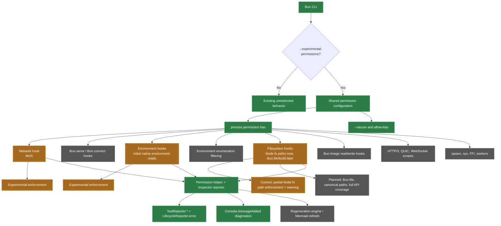

This feature is opt-in. Bun's default behavior remains unrestricted unless
`--experimental-permissions` is supplied.

The additive `process.permission.has()` API is available for diagnostics in
default mode and reports unrestricted access there; enforcement begins only
when the experimental gate is enabled.



Current implementation includes the gated CLI flags, the query API, the
permission helper, and the Inspector Protocol reporter. Filesystem access is
partially gated for Node fs path operations and still
emits a warning; Bun.file, path canonicalization/symlink handling, and full API
coverage remain planned. Initial native environment reads are gated. Ordinary JavaScript writes, cached
properties, deletion, enumeration, and special environment setters are not fully
mediated; this draft does not provide an environment isolation boundary. Additional network hooks (serve/connect)
and scopes such as subprocess, system information, FFI, and workers remain
planned.

The broader ecosystem vision—Bun.Image, HTTP/3/QUIC and WebSocket policy
scopes, subprocess/system/FFI/worker scopes, and a self-regenerating Mermaid
workflow—is represented as planned architecture here. It must not be read as
current enforcement coverage; each item needs its own runtime hook and focused
test before moving into the experimental/implemented classes above.

## Enforcement limits

This prototype is not a sandbox and must not run untrusted code. Filesystem
checks cover selected Node fs path operations, use lexical path grants, reject
parent (`..`) components, and accept directory grants with trailing separators.
They do not canonicalize symlinks or mediate every filesystem API. Existing file
descriptors are not reauthorized. `readFile` flags that request writing require
both read and write grants before opening the file.

Network grants match hostnames without ports; exact hosts and wildcard suffixes
are case-insensitive. With a restrictive network grant, automatic fetch redirects
are rejected because subsequent hops are not separately authorized. Explicit
`redirect: "manual"` remains available for inspecting a redirect and issuing a
new checked fetch. An unrestricted `--allow-net=*` retains normal redirect
behavior. Other networking APIs and native proxy connections are outside the
current enforcement coverage.

## Reporter output

The draft Inspector reporter emits an object with `tests` and `diagnostics`
arrays. Test durations use the protocol's elapsed milliseconds. Console and
lifecycle events have no test identifier: events received with exactly one
active test are attached to that test; events received with zero or multiple
active tests are retained in `diagnostics` with the active IDs and a reason.
This preserves ambiguous output without guessing which overlapping test emitted
it. This envelope replaces the earlier draft's bare test array.

## Development verification

Run these checks from this worktree:

```sh
bun install --frozen-lockfile
bun run typecheck:permissions
bun bd test test/cli/permissions.test.ts test/cli/inspect/permission-reporter.test.ts test/js/bun/test/expect-extend-preload.test.ts
bun test test/integration/bun-types/bun-types.test.ts
```

`typecheck:permissions` checks the permission tests, reporter, matcher regression
coverage, and their imported harness code using the repository's compiler
settings. It is a focused local check, not a whole-repository or CI gate.
The declaration integration suite checks packaged types with library checking
on, both with and without DOM declarations. Its JavaScript compiler fixture is
pinned to TypeScript 6.0.2 with Node 25 types; a separate CLI fixture checks the
stable TypeScript 7 compiler. The direct `bun test` declaration command is the
repository's documented exception for type-only validation. Native runtime
changes must use `bun bd` so the locally built permission hooks are exercised.
